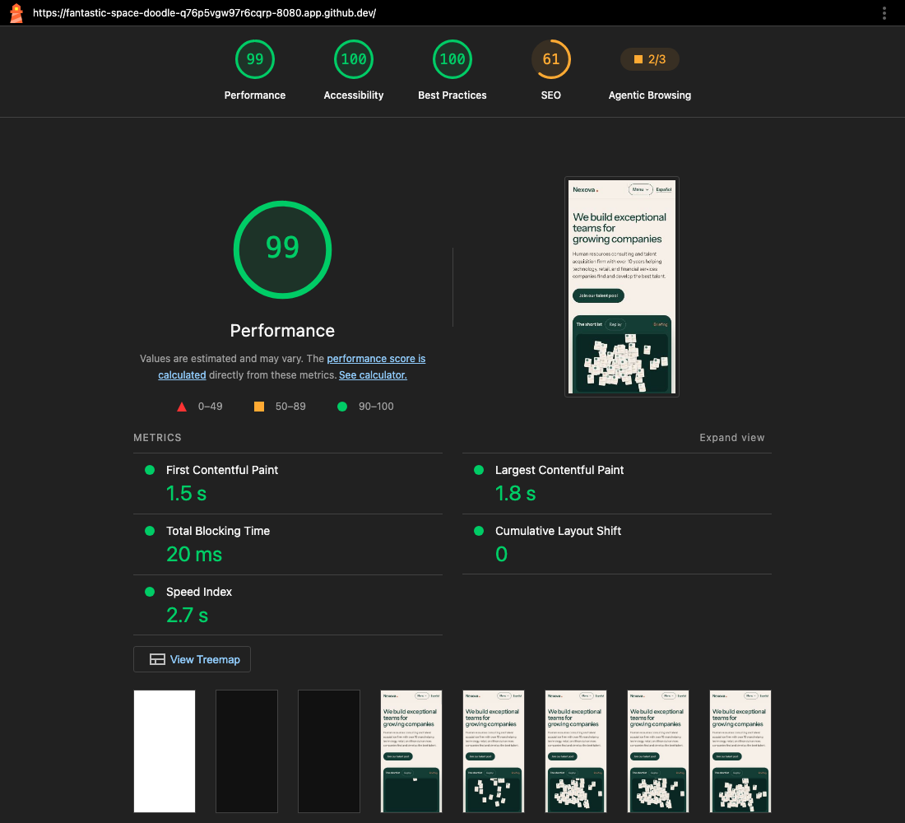
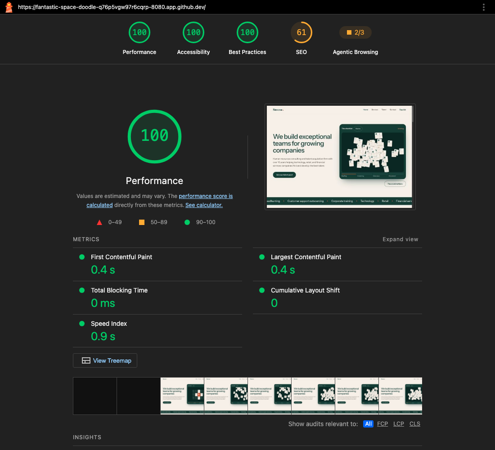
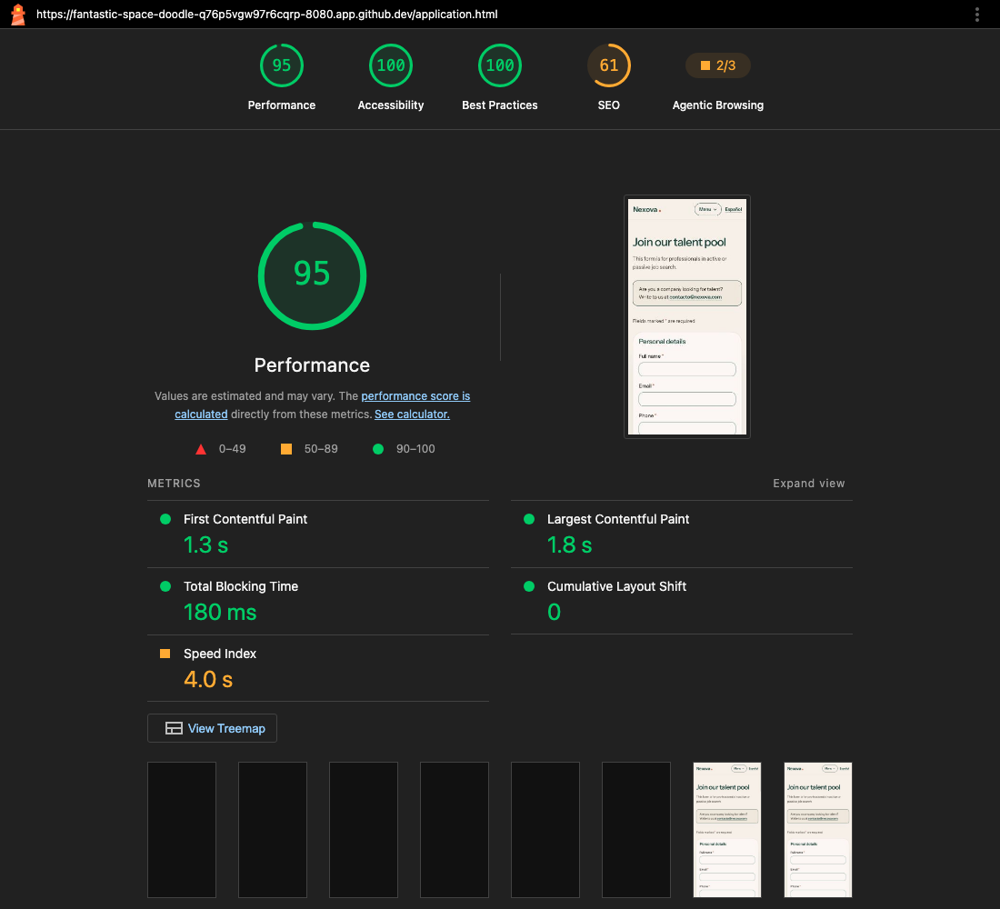
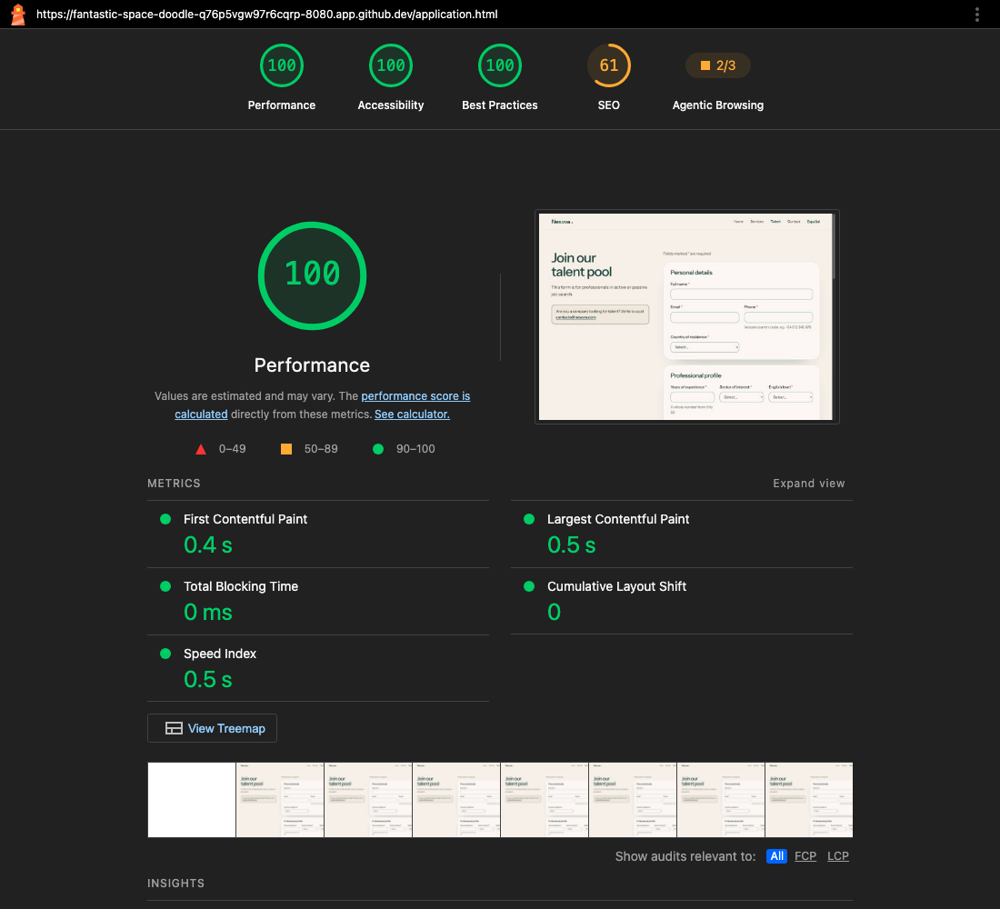

# Milestone 2 — Performance (PageSpeed Insights)

Evidence for criterion E13: "Performance verified with a minimum score of 80 (ideal above 90) using PageSpeed Insights on the public Codespaces URL".

- **Public URL:** <https://fantastic-space-doodle-q76p5vgw97r6cqrp-8080.app.github.dev/> (GitHub Codespaces, port 8080 set to Public by the developer)
- **Date:** 2026-10-23
- **Tool:** [PageSpeed Insights](https://pagespeed.web.dev/) (it reached the Codespace directly, so the Chrome DevTools fallback was not needed)
- **Served by:** `pnpm serve:site` (`dist/` only, no caching). Before the run, `/.env`, `/.git/config`, `/.mcp.json`, `/package.json` and `/memory-bank/` all returned 404 on the public URL.

The URL is temporary (a Codespaces port) and contains no secrets. That is acceptable for an academic project. The developer sets port 8080 back to **Private** after the pull request has been reviewed.

## Scores on the public URL

| Page | Device | Performance | Accessibility | Best practices | SEO |
| --- | --- | --- | --- | --- | --- |
| Home `/` | Mobile | **99** | 100 | 100 | 61 |
| Home `/` | Desktop | **100** | 100 | 100 | 61 |
| Form `/application.html` | Mobile | **95** | 100 | 100 | 61 |
| Form `/application.html` | Desktop | **100** | 100 | 100 | 61 |

Every Performance score is above 90 (minimum 80). Mobile metrics: home FCP 1.5 s, LCP 1.8 s, TBT 20 ms, CLS 0; form FCP 1.3 s, LCP 1.8 s, TBT 180 ms, CLS 0.

**Why SEO is 61 on the public URL:**
- GitHub Codespaces adds the header `x-robots-tag: noindex, nofollow` to every forwarded port (checked with `curl -I` on the public URL), and Lighthouse fails "Page is blocked from indexing" because of it.
- `robots.txt` did not exist yet when the screenshots were taken (see below).
- Neither comes from the pages themselves. On a real host (`nexova.com`) the header is not there.

### Screenshots

Home, mobile:

Home, desktop:

Form, mobile:

Form, desktop:

## Local Lighthouse for comparison

Lighthouse 13.5.0 run locally on the documented server (S08 command; reports in [`lighthouse/`](./lighthouse/)). The runs below are from S09, after `robots.txt` and `sitemap.xml` were added. The PageSpeed screenshots above were taken **before** that change.

| Page | Performance | Accessibility | Best practices | SEO |
| --- | --- | --- | --- | --- |
| `/` | 95 | 100 | 100 | 92 |
| `/application.html` | 100 | 100 | 100 | 92 |
| `/es/` | 100 | 100 | 100 | 92 |
| `/es/application.html` | 100 | 100 | 100 | 92 |

S08 recorded 100 / 100 / 100 / 92 on all four pages; Performance moves a few points between runs.

**Why local SEO stays at 92 after adding `robots.txt`:**
- The file is valid and served (`200 text/plain`), but Lighthouse fetches it from inside the page.
- The pages' Content-Security-Policy says `connect-src 'none'` (no network requests from page scripts, so form data cannot leave the browser), and that blocks Lighthouse's fetch: "Fetch of robots.txt failed: … CSP violation".
- Search engines read `robots.txt` directly, not through the page, so they see it.
- Allowing `connect-src 'self'` would turn this audit green; that is a security trade-off left to the developer.

## Why the scores are good

Compiled, minified Tailwind CSS (about 42 KB, only the classes used, no CDN), 1200 px WebP photos with explicit sizes and lazy loading, the self-hosted Instrument Sans font with `preload`, `defer`red scripts, a cascade animation that creates its work phase by phase (no long task), and no third-party requests at all.
