# Milestone 3 — Domain model (Nexova)

**Two sources, two colours in `model.png`:**
- **Official briefing (graded, exact):** `BRIEFING.md` (4Geeks `02-coding-fundamentals/nexova-BRIEFING.en.md`): `Candidate`, `Vacancy`, `SelectionProcess`, 18 functions. Names, fields and types copied exactly; never renamed or widened.
- **Extensions from `Company-choice.md`** (the developer's two agent ideas, as the teacher's guide asks: "read `company-choice.md` to identify the entities"): `ClientCompany`, `ClientVacancy`, `NexovaEmployee`, `RankingDecision`, `SupportTicket`, `KnowledgeBaseArticle`. In `src/types/models.ts` they sit under `// ===== Extensions from Company-choice.md =====`.

Industry comparison and market research: `benchmark.md`.

```mermaid
classDiagram
  direction LR
  class Candidate { +string id; +string fullName; +string email; +string phone; +number yearsOfExperience; +string[] skills; +EnglishLevel englishLevel; +SeniorityLevel seniority; +number currentSalary; +number expectedSalary; +AvailabilityStatus availability; +string location; +boolean remoteOnly; +CandidateStatus status }
  class Vacancy { +string id; +string title; +string companyName; +string[] requiredSkills; +string[] preferredSkills; +number minYearsExperience; +number maxYearsExperience; +EnglishLevel requiredEnglishLevel; +SeniorityLevel requiredSeniority; +number salaryRangeMin; +number salaryRangeMax; +boolean isRemote; +string location; +VacancyStatus status }
  class SelectionProcess { +string id; +string candidateId; +string vacancyId; +ProcessStage stage; +number score; +string notes; +Date createdAt; +Date updatedAt }
  class ClientVacancy { +string clientId; +string consultantId }
  class ClientCompany { +string id; +string name; +string taxId; +string contactEmail; +NexovaOffice office; +NexovaService[] services }
  class NexovaEmployee { +string id; +string fullName; +string email; +EmployeeRole role; +NexovaOffice office }
  class RankingDecision { +string id; +string vacancyId; +string candidateId; +string consultantId; +number suggestedRank; +number finalRank; +RankingDecisionType decision; +string reason; +Date decidedAt }
  class SupportTicket { +string id; +string clientId; +TicketChannel channel; +string query; +TicketStatus status; +SupportLevel level; +string|null assignedAgentId; +string escalationSummary; +Date createdAt; +Date|null resolvedAt }
  class KnowledgeBaseArticle { +string id; +string clientId; +string title; +string problem; +string solution; +string[] keywords; +string|null sourceTicketId; +Date createdAt }
  Vacancy <|-- ClientVacancy
  Candidate "1" --> "0..*" SelectionProcess
  Vacancy "1" --> "0..*" SelectionProcess
  ClientCompany "1" --> "0..*" ClientVacancy
  ClientCompany "1" --> "0..*" SupportTicket
  ClientCompany "1" --> "0..*" KnowledgeBaseArticle
  NexovaEmployee "1" --> "0..*" ClientVacancy : consultant
  NexovaEmployee "1" --> "0..*" RankingDecision : consultant
  NexovaEmployee "0..1" --> "0..*" SupportTicket : agent
  Vacancy "1" --> "0..*" RankingDecision
  Candidate "1" --> "0..*" RankingDecision
  SupportTicket "0..1" --> "0..1" KnowledgeBaseArticle : sourceTicketId
```

## Union types
- Briefing: `EnglishLevel` A1<A2<B1<B2<C1<C2<Native · `SeniorityLevel` Junior<Semi-Senior<Senior<Lead<Executive · `AvailabilityStatus` = "Immediate" | "2 weeks" | "1 month" | "Not available" · `CandidateStatus` = "Active" | "In process" | "Hired" | "Inactive" · `VacancyStatus` = "Open" | "In progress" | "Closed" | "On hold" · `ProcessStage` = "Screening" | "Interview" | "Technical test" | "Final interview" | "Offer" | "Rejected" | "Hired".
- Extensions: `NexovaOffice` = "Valencia" | "Miami" · `NexovaService` = "Talent Selection" | "Customer Support" · `EmployeeRole` = "Selection Consultant" | "Support Agent" · `TicketChannel` = "Chat" | "Email" | "Widget" | "Phone" · `TicketStatus` = "Open" | "Resolved" · `SupportLevel` = "L1" | "L2" · `RankingDecisionType` = "Accepted" | "Overridden".
- Computed, not stored: `ScoreBreakdown` (points per part + matched/missing skills), `SlaStatus` = "On time" | "At risk" | "Breached" (SLA 24 h, imported from `packages/shared/company.ts`; at risk from 20 h), `ValidationResult` = `{ valid: boolean; errors: string[] }`, `isHighMatch(score)` (score ≥ 90). An escalation is a ticket with `level === "L2"`.

## Linking without changing the briefing
`interface ClientVacancy extends Vacancy { clientId: string; consultantId: string }`: a `ClientVacancy` can be passed wherever a `Vacancy` is expected, so the 18 briefing functions are unchanged. A process reaches its consultant through `process.vacancyId → ClientVacancy.consultantId`. Candidate isolation per client: client → its vacancies → their processes → candidates.

## Validation rules
| Entity | Rules | Source |
|---|---|---|
| Candidate | 0 ≤ experience ≤ 50; both salaries > 0; at least 1 skill; valid email; phone not empty | Briefing |
| Vacancy | at least 1 required skill; min experience ≥ 0; max ≥ min; salary max ≥ min, both > 0 | Briefing |
| SelectionProcess | score 0–100; updatedAt ≥ createdAt; ids not empty | Addition |
| ClientCompany | name and taxId not empty; valid contactEmail; at least 1 service | Extension |
| SupportTicket | clientId required; resolvedAt ≥ createdAt; L2 needs escalationSummary; Resolved needs resolvedAt | Extension |

## Client isolation
`clientId` is the tenant id. Briefing entities and `RankingDecision` reach their client through the vacancy; `NexovaEmployee` is internal staff (no tenant). Ticket status, age and KPI functions receive a list already filtered with `filterTicketsByClient`.

## Traceability (why each extension exists)
| Entity | Company-choice.md says |
|---|---|
| ClientCompany | "candidate data from one Nexova client can never mix with another's"; tickets are "tagged with the client company" |
| ClientVacancy | HR enters "a new opening" for a client; links vacancy → client and consultant |
| NexovaEmployee | 40 recruiting consultants; 30 support agents; L2 "escalates to a human agent" |
| RankingDecision | "a log of whether the consultant accepts the ranking as-is or reorders it manually" (override rate) |
| SupportTicket | "a ticket arrives via chat, email, or the support widget, tagged with the client company"; L1 / L2; SLA 24 h |
| KnowledgeBaseArticle | "checks a knowledge base for a similar already-solved case… scoped to that client"; human-resolved cases written back |
| **Not included:** ClientRequest | Not in Company-choice.md (a peer's model); backlog |

## Functions by module (pure; explicit types; inputs never mutated; time functions receive `now`)
| File | Briefing | Additions / extensions |
|---|---|---|
| `src/utils/search.ts` | findCandidateById, findCandidateByEmail, binarySearchCandidateBySalary | searchKnowledgeBase(articles, clientId, keyword) |
| `src/utils/collections.ts` | filterCandidatesBySkills, filterCandidatesBySeniority, filterCandidatesByAvailability, sortCandidatesBySalary, sortCandidatesByExperience | filterTicketsByClient, filterTicketsByStatus, sortTicketsByAge |
| `src/utils/transformations.ts` | calculateCandidateScore, rankCandidatesForVacancy, groupCandidatesBySeniority, countCandidatesByStatus, calculateAverageSalary, findTopSkills, calculateVacancyFillRate | getCandidateScoreBreakdown, isHighMatch, countProcessesByStage, calculateAverageTimeToHire, getSlaStatus, calculateL1ResolutionRate, calculateAverageResolutionHours, calculateOverrideRate |
| `src/utils/validations.ts` | validateCandidate, validateVacancy, isValidEmail | validateSelectionProcess, validateSupportTicket, validateClientCompany |
| `src/utils/levels.ts` | — | compareEnglishLevel, seniorityDistance |
| `src/data/sampleData.ts` | briefing samples | worked case (one vacancy, several candidates; one candidate in two vacancies of the same client), 2 clients, employees, tickets, KB articles, ranking decisions |

Match score 0–100: skills 40 (capped) · experience 20 · seniority 15 · English 15 · salary 10. Sample: Carolina 100 · María 82 · Juan 10. Company-choice KPIs: L1 ≥ 40 %, average resolution < 24 h, override rate.

## Progress (updated by every step)
| Part | Files | Step | Status |
|---|---|---|---|
| Types (briefing + extensions), ladders, sample data | `src/types/models.ts`, `src/utils/levels.ts`, `src/data/sampleData.ts` | S02 | Done ([M3-S02]) |
| Search | `src/utils/search.ts` | S03 | Done ([M3-S03]) |
| Filters and sorts | `src/utils/collections.ts` | S04 | Pending |
| Score breakdown, score, ranking, grouping | `src/utils/transformations.ts` | S05 | Pending |
| Reports and KPIs (recruitment + support) | `src/utils/transformations.ts` | S06 | Pending |
| Validations | `src/utils/validations.ts` | S07 | Pending |
| Demo and test page | `src/demo.ts`, `src/index.html` | S08 | Pending |
